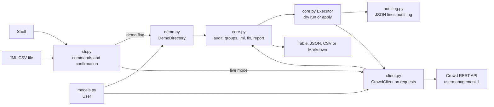

# crowdkeeper

Access hygiene and joiner, mover, leaver (JML) CLI for Atlassian Crowd admins: finds inactive and orphaned accounts, tracks group drift, and applies JML changes with an audit log.

[](https://github.com/chriswayneh/crowdkeeper/actions/workflows/ci.yml)
[](LICENSE)
[](pyproject.toml)

It talks to Crowd's REST API (`/rest/usermanagement/1`) using application authentication. `jml` and `fix` are dry-run by default.

## Quick start

```bash
git clone https://github.com/chriswayneh/crowdkeeper.git
cd crowdkeeper
pip install .
crowdkeeper --demo audit
```

Requires Python 3.10 or newer. `--demo` uses a built-in fake directory, so no Crowd server is needed.

## Usage

### Commands

| Command | What it does |
|---|---|
| `audit [--days N] [-o table\|json\|csv]` | Inactive users (last login N+ days ago), users with no recorded login (flagged for review, never auto-deactivated), active users with no groups, disabled users still in groups, empty groups |
| `groups export [-f FILE]` | Dump group membership as JSON |
| `groups diff A B` | Show access drift (granted/revoked/group added/removed) between two exports |
| `jml FILE.csv [--apply]` | Joiners (create + add groups), movers (set groups), leavers (deactivate, then strip groups) |
| `fix [--apply]` | Apply the audit's recommended cleanups (deactivate inactive, strip groups from disabled users) |
| `report [-f FILE]` | One-page Markdown summary for auditors |

**Safety:** `jml` and `fix` are dry-run by default. Changes happen only with `--apply` plus a typed
`yes` confirmation (or `-y`). If stdin is not a terminal (piped, redirected, cron, CI) and `-y` isn't
passed, the prompt refuses, nothing is changed, and the command exits with status 2 so cron and CI
see a failure. Declining at an interactive prompt still exits 0. Every applied change is appended to the audit log (`--log`, default
`crowdkeeper-audit.json`) as JSON lines. Password fields are never logged.
Right before applying, crowdkeeper reads the directory again and re-plans; if the plan differs from
the one you confirmed (someone changed a user or group in the meantime), it stops with exit 1 and
changes nothing, so run the command again to review the new plan. A change made after that re-check
and during the apply itself is not detected.

**Membership is direct group memberships only.** crowdkeeper reads and changes direct memberships
(`/user/group/direct`). Access a user gets through nested groups is not shown by `audit`, `report` or
`groups export`, and a leaver keeps any nested-group access until the parent membership is removed
(deactivation still blocks login).

**Exit codes:**

| Code | Meaning |
|---|---|
| 0 | Success, a dry run, nothing to do, or declined at the interactive prompt |
| 1 | A Crowd, network or file error (including a redirect, a non-2xx answer or a malformed response), an invalid `groups diff` snapshot, the directory changing between the confirmed preview and the apply (nothing changed), or a partial apply (including Ctrl-C during `--apply`) |
| 2 | A usage error (bad arguments, from argparse), a malformed JML CSV (empty file with no header, a duplicate, blank or missing required header, broken quoting, a row with more or fewer values than the header, text that isn't UTF-8, or a control or invisible character such as NUL, tab, ESC, U+202E or U+200B in any field), an invalid JML row (unknown action or group, missing username, a mover or leaver who doesn't exist), or `--apply` on non-TTY stdin without `-y` |

**Audit log format:** each change writes two lines. An `intent` line is written *before* the change
is sent to Crowd, and an `applied` line after it succeeds, so even a Ctrl-C or kill mid-change leaves
a record. An `intent` with no matching `applied` or `failed` line (same `run_id` and `seq`) means the
outcome is unknown; check that change in Crowd. The change's own fields sit under a nested `detail` object, so
they can never overwrite the top-level fields. `seq` restarts at 1 each run; `run_id` is a random
per-run id, so `(run_id, seq)` identifies a change across runs appended to the same log. A `failed`
entry's `stage` is `intent_log` (change not attempted), `change` (the Crowd call failed) or
`applied_log` (the change *was* made, `change_applied: true`, but its `applied` line failed).
`change_applied` is `false` only when the change provably was not made (its `intent` line could not be
written, or Crowd rejected it with an HTTP 4xx). Otherwise it is `null` (unknown): a Ctrl-C, timeout,
lost connection or 5xx may come after Crowd already applied it, so check that change in Crowd.
`applied_before_failure` counts every change made in the run, including that one. This format
replaces the single-line-per-change format of earlier versions; update any log readers.

```json
{"ts": "2026-10-15T02:10:01+00:00", "event": "intent", "action": "deactivate-user", "seq": 1, "run_id": "9f2c...", "detail": {"user": "frank", "reason": "last login 140d ago"}}
{"ts": "2026-10-15T02:10:01+00:00", "event": "applied", "action": "deactivate-user", "seq": 1, "run_id": "9f2c...", "detail": {"user": "frank", "reason": "last login 140d ago"}}
{"ts": "2026-10-15T02:10:02+00:00", "event": "intent", "action": "remove-from-group", "seq": 2, "run_id": "9f2c...", "detail": {"user": "ivan", "group": "jira-users"}}
{"ts": "2026-10-15T02:10:02+00:00", "event": "failed", "action": "remove-from-group", "seq": 2, "run_id": "9f2c...", "stage": "change", "change_applied": null, "error": "ReadTimeout: ...", "applied_before_failure": 1, "detail": {"user": "ivan", "group": "jira-users"}}
```

**Partial failures:** if a change fails partway through `jml --apply` or `fix --apply` (including
Ctrl-C), crowdkeeper stops at that change. Every change already applied is in the audit log, followed
by a `"event": "failed"` entry for the failed change with the error (secrets scrubbed) and the count of
changes applied before it. The command then exits with status 1. If the audit log itself can't be
written (full disk, bad permissions), the original error and the log error are printed to stderr and
the command still exits 1; if the `intent` line can't be written, the change is not attempted. Nothing
is rolled back automatically; use the log to finish or reverse the run.

**Login activity:** `audit` and `fix` use Crowd's `lastAuthenticated` attribute, which Crowd only
updates on some logins (SSO and remembered sessions in connected apps may not update it). A user with
no recorded login is reported as `activity-unknown` (review) once the account is older than `--days`
(or its creation date is unknown), and `fix` never deactivates them. `--days` must be at least 1.

**Approved plan only:** `--apply` executes exactly the plan you confirmed; it does not re-read Crowd and
re-plan after the prompt. Prompts and status messages go to stderr, so stdout is just the table/JSON/CSV.
Output is terminal-safe: in the table and CSV formats, the Markdown report and error messages,
tabs, line breaks and every control, bidi, zero-width or line/paragraph separator character in a
name are shown as Python-style escapes (`\t`, `\n`, `\u001b`, `\u202e`), and a literal backslash
is doubled (`\\`). So a hostile name can't inject terminal escapes or reorder text, and a name that
really contains the text `\u001b` (shown as `\\u001b`) never looks like a real ESC. CSV also keeps
its spreadsheet-formula guard (a leading `'` before `=`, `+`, `-`, `@`). JSON keeps the exact value,
with those characters written as JSON `\uXXXX` escapes, so use `-o json` when you need the raw name.
In the report, names are escaped so GitHub (cmark-gfm) and linkify renderers show them as plain
text: no links (every `.` is escaped and each `@` is put in a code span, so URLs, bare domains and
e-mail addresses don't autolink), no emphasis and no HTML.

JML CSV format (`groups` separated by `;` or spaces; for movers it's the full target set). The
`action` and `username` columns are required; the only allowed columns are `action`, `username`,
`display_name`, `email` and `groups` (spaces around a header name are ignored, and any other column
is rejected with exit 2, so a misspelled `group` can't be silently ignored). A leaver is deactivated
first and then removed from each group, so a failed removal never leaves the account active. The file must be UTF-8 (a leading BOM is fine). The CSV is parsed strictly: an empty file, a duplicate, blank or missing required column header (for
example two `groups` columns), broken quoting (an unclosed `"`, or text after a closing quote),
a row with more or fewer values than the header (write empty cells as `,,`), bytes that aren't
UTF-8, or a control or invisible character (NUL, tab, ESC, a line break inside quotes, bidi or
zero-width characters) in any field stops the run with the line number and exit code 2 before anything is planned or changed. The whole file is checked before anything is planned or changed, including through the Python
API with `Executor(apply=True)`: an unknown action, an empty username, a mover or leaver who
doesn't exist (counting users created by earlier joiner rows), unknown groups or malformed rows are
all reported with their real file line numbers (blank lines counted) and exit code 2, and nothing is changed. Rows run in
order, so several rows for one user build on each other. For a mover, a missing `groups` column
or a blank cell (empty, only spaces, or only `;`) leaves memberships alone; it is
never read as "remove all". To remove every group, write the explicit marker `-` or `none`
(case-insensitive, unquoted). To name a real group literally called `none` or `-`, wrap it in
single quotes inside the cell, e.g. `jira-users;'none';'-'`; any single-quoted token is taken as a
literal group name, never as the marker. Quotes cannot protect spaces or `;` (they still split
tokens), and an unbalanced (`'none`) or empty (`''`) quote is kept as-is and so fails as an unknown
group with the line number; nothing is changed. Combining `-`/`none` with group names is a validation error with the line number:

```csv
action,username,display_name,email,groups
joiner,newhire,New Hire,newhire@example.com,jira-users;confluence-users
mover,bob,,,jira-users;confluence-users
mover,carol,,,-
leaver,frank,,,
```

### Demo mode

`--demo` or `CROWDKEEPER_DEMO=1` uses a built-in directory of 25 users and 8 groups with
planted problems. Demo mode never writes anything to a directory; `--apply` falls back to a dry run.

```bash
crowdkeeper --demo audit
crowdkeeper --demo fix
crowdkeeper --demo jml examples/jml.csv
crowdkeeper --demo report
```

### Live mode

```bash
export CROWD_URL=https://crowd.example.com/crowd   # https required; no user:pass@ in the URL
export CROWD_APP=crowdkeeper
export CROWD_APP_PASSWORD=...   # never logged or written to the audit log
crowdkeeper audit --days 90
```

`CROWD_URL` must be `https://`. Plain `http://` is refused for every host, localhost included,
unless you pass the global `--insecure` flag (e.g. `crowdkeeper --insecure audit` against a local
test server); that sends the application password unencrypted and prints a warning. URLs with
embedded credentials are always refused. See [SECURITY.md](SECURITY.md) for supported versions and
how to report a vulnerability privately.

The Crowd client (`crowdkeeper/client.py`) is written directly on `requests` against
`/rest/usermanagement/1`, because there is no maintained Python Crowd client worth depending on.
It never follows redirects: any answer other than 2xx (a 3xx to a login page included) is an error,
so a change is only logged as applied when Crowd confirmed it. A response that doesn't have the
expected shape (for example no `users` or `groups` list) is an error too, never an empty result.
Deactivation sends Crowd only the user's name, first and last name, display name, e-mail and
`active: false`, not the whole fetched record; Crowd has no conditional update for users, so a
profile edit made at the same moment can still be overwritten.

### Sample output

```text
$ crowdkeeper --demo audit
type                subject               detail                                        fix
------------------  --------------------  --------------------------------------------  ------------
inactive            frank                 last login 140d ago                           deactivate
inactive            heidi                 last login 220d ago                           deactivate
disabled-in-groups  ivan                  disabled but in: bitbucket-users, jira-users  strip-groups
disabled-in-groups  mallory               disabled but in: finance, jira-admins         strip-groups
activity-unknown    olivia                no recorded login (account 600d old)          review
no-groups           olivia                active user in no groups                      review
inactive            rupert                last login 95d ago                            deactivate
disabled-in-groups  trent                 disabled but in: contractors                  strip-groups
no-groups           victor                active user in no groups                      review
inactive            svc-backup            last login 365d ago                           deactivate
no-groups           svc-backup            active user in no groups                      review
empty-group         legacy-sox-approvers  group has no members                          review
```

```text
$ crowdkeeper --demo fix
action             user        group
-----------------  ----------  ---------------
deactivate-user    frank
deactivate-user    heidi
remove-from-group  ivan        bitbucket-users
remove-from-group  ivan        jira-users
remove-from-group  mallory     finance
remove-from-group  mallory     jira-admins
deactivate-user    rupert
remove-from-group  trent       contractors
deactivate-user    svc-backup

Dry run: 9 change(s) planned, nothing written. Use --apply to execute.
```

```text
$ crowdkeeper --demo jml examples/jml.csv
action             user     group
-----------------  -------  ----------------
create-user        newhire
add-to-group       newhire  jira-users
add-to-group       newhire  confluence-users
remove-from-group  bob      bitbucket-users
add-to-group       bob      confluence-users
remove-from-group  frank    finance
remove-from-group  frank    jira-users
deactivate-user    frank

Dry run: 8 change(s) planned, nothing written. Use --apply to execute.
```

```text
$ crowdkeeper --demo groups export -f a.json
Wrote a.json
$ # (a.json edited: zoe added to jira-admins, carol removed from finance, saved as b.json)
$ crowdkeeper groups diff a.json b.json
change   group        user
-------  -----------  -----
revoked  finance      carol
granted  jira-admins  zoe
```

`crowdkeeper --demo report` output:

```markdown
# Crowd Access Review

Generated: 2026-10-01 00:00 UTC  
Inactivity threshold: 90 days

## Summary

| Metric | Count |
|---|---|
| Users | 25 |
| Active users | 21 |
| Groups | 8 |
| Inactive users (>= 90d) | 4 |
| Active users with unknown login activity | 1 |
| Active users with no groups | 3 |
| Disabled users still in groups | 3 |
| Empty groups | 1 |

## Findings

- **inactive** `frank`: last login 140d ago (recommended: deactivate)
- **inactive** `heidi`: last login 220d ago (recommended: deactivate)
- **disabled-in-groups** `ivan`: disabled but in: bitbucket-users, jira-users (recommended: strip-groups)
- **disabled-in-groups** `mallory`: disabled but in: finance, jira-admins (recommended: strip-groups)
- **activity-unknown** `olivia`: no recorded login (account 600d old) (recommended: review)
- **no-groups** `olivia`: active user in no groups (recommended: review)
- **inactive** `rupert`: last login 95d ago (recommended: deactivate)
- **disabled-in-groups** `trent`: disabled but in: contractors (recommended: strip-groups)
- **no-groups** `victor`: active user in no groups (recommended: review)
- **inactive** `svc-backup`: last login 365d ago (recommended: deactivate)
- **no-groups** `svc-backup`: active user in no groups (recommended: review)
- **empty-group** `legacy-sox-approvers`: group has no members (recommended: review)

## Group sizes

| Group | Members |
|---|---|
| bitbucket-users | 5 |
| confluence-users | 9 |
| contractors | 3 |
| finance | 4 |
| hr | 2 |
| jira-admins | 3 |
| jira-users | 13 |
| legacy-sox-approvers | 0 |

_Produced by crowdkeeper. Remediate with `crowdkeeper fix` (dry-run by default)._
```

## Architecture

`cli.py` picks a directory: `DemoDirectory` from `demo.py`, or `CrowdClient` from `client.py`, which calls the Crowd REST API with `requests`. Both return `User` objects from `models.py`. `core.py` runs the audit, group export and diff, JML and fix planning, and the Markdown report. Changes go through the `Executor` in `core.py`, which stays a dry run without `--apply` and writes `intent`, `applied` and `failed` lines through `auditlog.py`.



## Roadmap

See [ROADMAP.md](ROADMAP.md). See [CHANGELOG.md](CHANGELOG.md) and the GitHub releases for the current version. Phase 0 is done and Phase 1 (harden live mode) is next.

## Development

```bash
pip install -e ".[test]"
pytest
```

## License

MIT. See [LICENSE](LICENSE).
